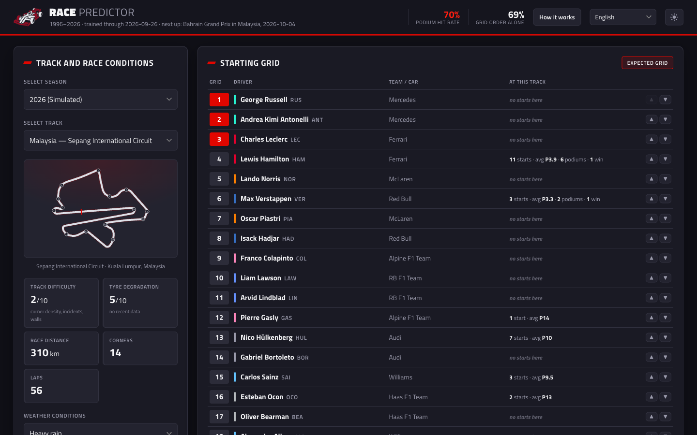
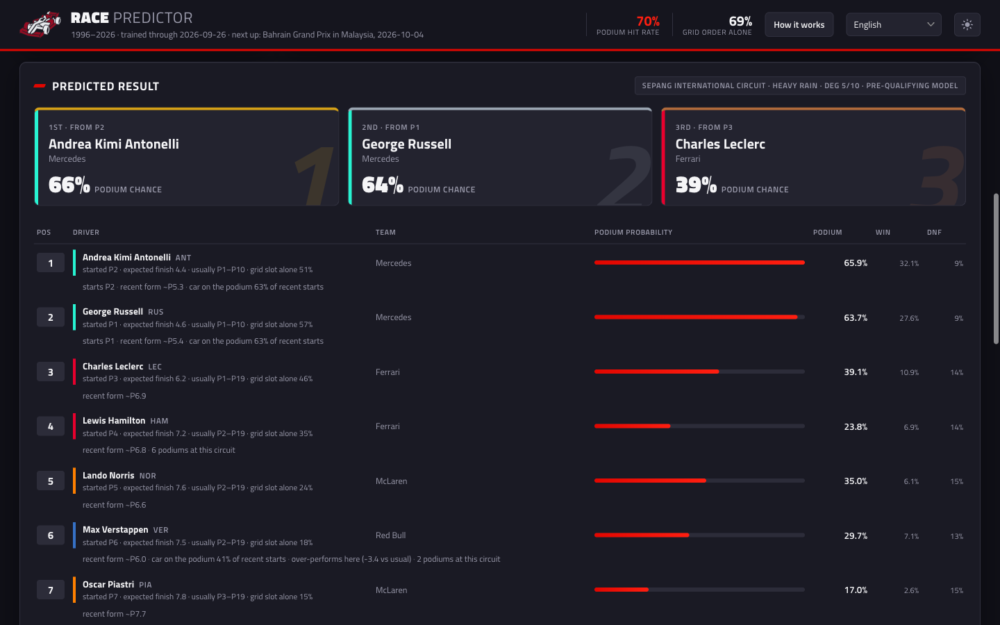
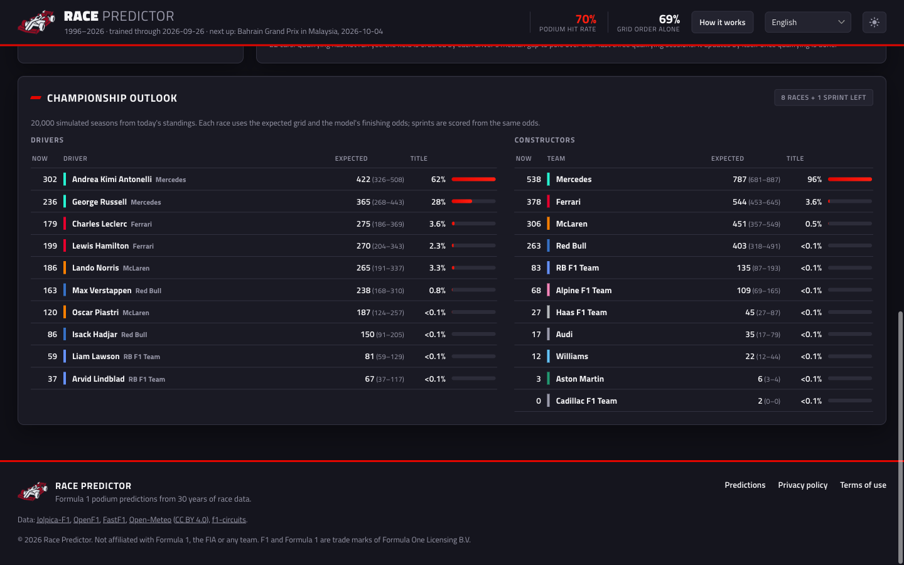
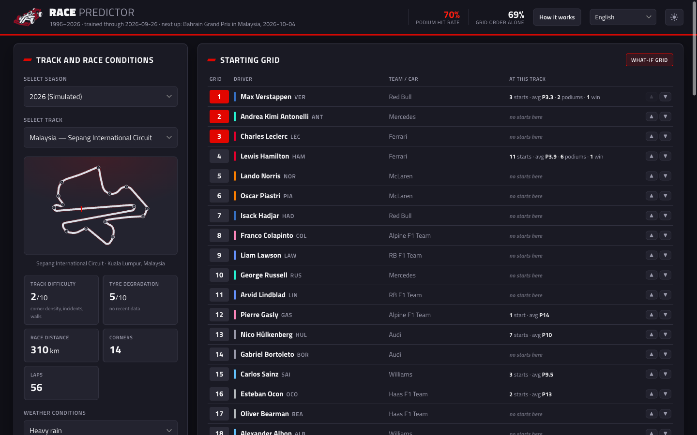
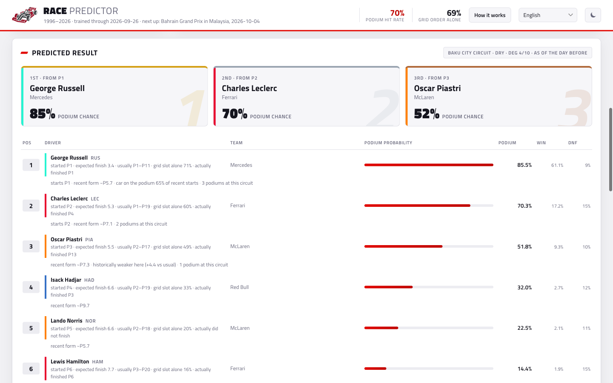
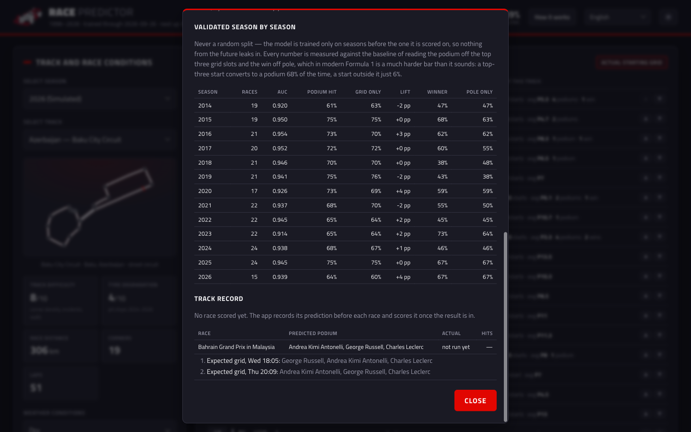
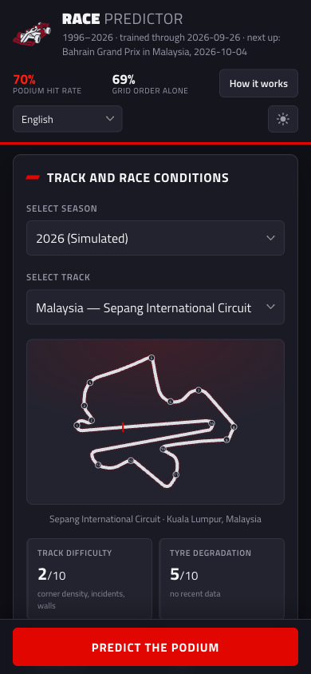
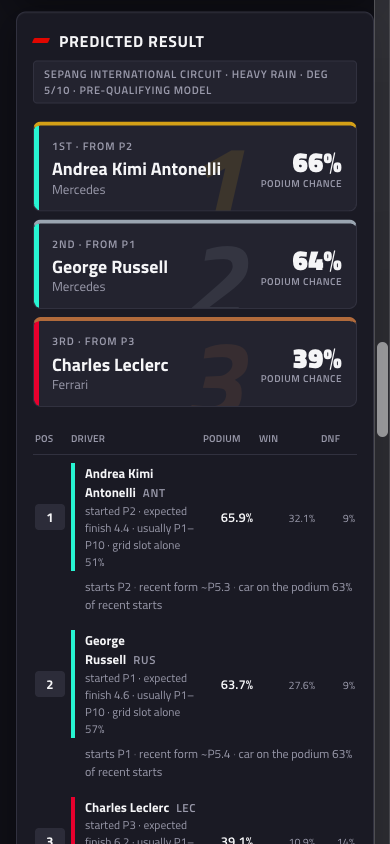
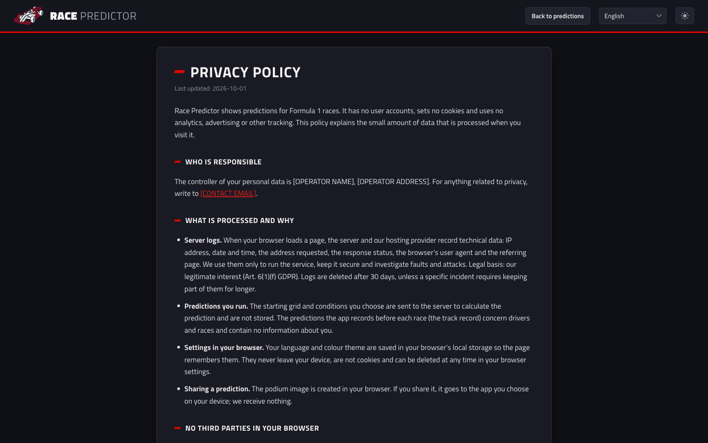
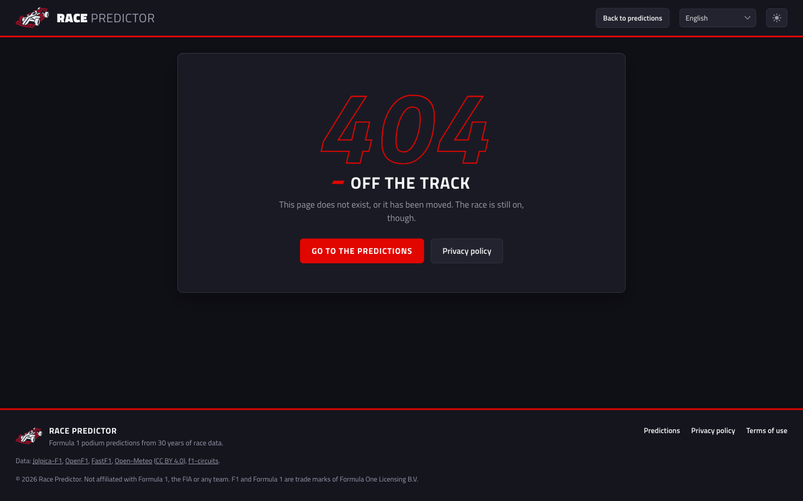

# Race Predictor

[Polski](README.md) · **English**


> Predicts the podium of every Formula 1 Grand Prix from three decades of real results, and shows where each number comes from.

Race Predictor is a web app that, before every F1 race, works out each driver's chances of winning, finishing on the
podium, scoring points and failing to finish. It takes into account the starting grid, the current form of the driver
and the car, the driver's history at that circuit, the character of the track, the weather and the weekend's practice
sessions. Every probability comes from 20,000 simulated races, so they always agree with each other. On top of that:
a championship outlook for the rest of the season, "what if" scenarios and a track record in which the app scores
its own earlier predictions.

Under the hood: Python, Flask and scikit-learn, with a frontend in plain HTML, CSS and JavaScript — no framework and
no build step. Data is fetched automatically from public sources (Jolpica-F1, OpenF1, FastF1, Open-Meteo), and the
app keeps an eye on the calendar in the background, downloads results and retrains the model after every race. The
interface is available in eight languages.



## Who it is for

- **F1 fans** who want to know before the weekend who is realistically fighting for the podium, and why. Every
  driver gets a short explanation: form, car pace, results at this circuit, reliability risk.
- **People learning data science** who are looking for an honestly validated model on time-series data: no leakage
  from the future, season-by-season validation and a comparison against a simple baseline. The full model write-up
  is in [`docs/model.md`](docs/model.md).
- **Integrators** who want to pull predictions through the API — documentation in
  [`docs/api-documentation.pdf`](docs/api-documentation.pdf).

This is not a betting tool or betting advice. The model will not "outsmart" qualifying: in F1 the starting grid is
the strongest single signal, and the app adds calibrated probabilities on top of it. It is also not an official
Formula 1 product.

## How it works

```
Jolpica-F1  ─┐
OpenF1      ─┤                                       ┌─► features.csv ──────────┐
FastF1      ─┼─► scripts/01*_fetch ─► data/raw ─► 02_build_features              ├─► 03_train ─► models/podium_model.joblib
Open-Meteo  ─┤                                       └─► features_prequali.csv ─┘
f1-circuits ─┘

Browser ──► Flask (src/app/server.py)
              ├──► /             interface (HTML + CSS + JS, 8 languages)
              ├──► /api/*        JSON API: calendar, grid, prediction, championship, track record
              └──► background    every 15 min: data sync (src/pipeline.py)
                   thread        and pre-race prediction recording (data/ledger/)
```

**Data.** The `01*` scripts fetch results, qualifying, sprints, pit stops, practice sessions, race laps, safety cars
and weather from 1996 onwards, cached in `data/raw`. `02_build_features` walks through history in chronological
order and, for every car in every race, builds 72 features from what was known **before the start**. `03_train`
trains the model and validates it season by season.

**A single race prediction** works like this:

1. The app determines the starting grid: before qualifying an expected one (the median gap to pole over the last
   three qualifying sessions, blended with practice pace once practice has run), after qualifying the qualifying
   result, and once OpenF1 publishes the official grid — the order including penalties.
2. Three gradient boosting classifiers score every car: chance of a win, a podium and points.
3. Each score is blended with how much a start from that grid slot has historically been worth. Before qualifying a
   separate model is used, trained on expected grids, which puts more weight on form and track history.
4. Everything goes through 20,000 simulated races with random breakdowns, crashes and disqualifications. Every
   number on screen comes from that one simulation.

**A race weekend** runs itself:

1. A week before the race the app records its first prediction in the track record.
2. After practice (Friday) it records a new version with a grid that takes practice into account.
3. After qualifying (Saturday) — a version with the qualifying result, and once penalties appear — with the official
   grid.
4. At the start of the race the prediction is frozen.
5. After the race the sync downloads the result, retrains the model and scores every prediction version separately.

## The model in brief

- **Features** (72): grid slot and qualifying gap; driver and car form with decay (0.93 per race); record against the
  team mate; the driver's history at this circuit relative to their usual form; the character of the track (how much
  it shuffles the order, how often pole wins, how many cars retire); weather measured in the Open-Meteo archive;
  practice pace; position relative to the rest of the field (how many faster cars start ahead of you).
- **Older races count less:** weight `0.5 ^ (years back / 8)`. At the start of every new technical regulation era,
  team form is decayed to 30%.
- **Validation** is always "forward": the model for season S learns only from seasons before S. Results for
  2014–2026 (267 races):

| | model | grid order alone |
|---|---|---|
| podium places hit | **69.7%** | 68.9% |
| winner hit | **55.8%** | 54.3% (pole position) |
| exact podium hit | **30.0%** | 28.1% |

- **Before qualifying** (grid expected, not known):

| | pre-qualifying model | post-qualifying model | expected grid alone |
|---|---|---|---|
| podium places hit | **60.0%** | 59.2% | 58.8% |
| winner hit | **42.1%** | 37.1% | 35.9% |
| podium different from the grid | 24% of races | 7% of races | — |

- **Tried and rejected**, because validation showed no improvement: continuity of team history across renames
  (e.g. Sauber → Audi), sprint results, safety car frequency as a model feature, monotonic constraints.

All the details, numbers and reasons behind each decision: [`docs/model.md`](docs/model.md).

## Features

**Interface**

| Part | What it does |
|---|---|
| Track and race conditions | Season and track picker, track map with corner numbers, difficulty, tyre degradation, distance, weather (from the forecast for the next race), track statistics including safety cars |
| Starting grid | Grid set automatically, with a source label; team-colour bar; the driver's history at this track; ▲/▼ buttons for "what if" scenarios |
| Predicted result | Podium with chances, full order, win and DNF chances, "grid slot alone" for comparison, a short explanation for every driver |
| Share the podium | A 1200×630 image for social media (the share menu on a phone, a PNG file on a computer) |
| Championship outlook | 20,000 simulated seasons: expected points, range and title chance for drivers and constructors |
| How it works | Model description, season-by-season validation, track record split by weekend stage |
| Past race | The "day before the race" prediction next to the actual result |

Plus a dark and a light theme (remembered), eight languages (English, Polish, German, Spanish, French, Italian,
Dutch, Brazilian Portuguese), full phone support with a sticky "Predict the podium" button at the bottom of the
screen, and loading skeletons and progress indicators for every load.

**Pages**

| Address | What it is |
|---|---|
| `/` | The prediction app |
| `/privacy` | Privacy policy (8 languages) |
| `/terms` | Terms of use (8 languages) |
| any other address | "Off the track" 404 page with a link back to the predictions |
| `/robots.txt`, `/sitemap.xml` | For search engines: every page in every language with `hreflang` alternates |

Every page has its own title, description, canonical address and Open Graph / Twitter tags with a 1200×630 image
([`og-image.png`](src/app/static/brand/og-image.png)), in each of the 8 languages (`?lang=pl`, `?lang=de`…). The home
page has schema.org structured data (`WebApplication`), and the tab title changes with the selected race. All pages
share a header with the language and theme switchers and a footer with links to the privacy policy, terms of use,
data sources and a trade mark disclaimer.

**API**

| Endpoint | What it returns |
|---|---|
| `GET /api/bootstrap` | Tracks, drivers, teams, calendar, next race with weather, sync status, validation results |
| `GET /api/track/{circuit_id}` | Full track description with the outline for the map |
| `GET /api/lineup` | Starting grid for a race and its source |
| `GET /api/driver/{driver_id}` | Driver profile with results at every track |
| `POST /api/predict` | Race prediction for the given grid |
| `GET /api/championship` | Championship outlook for the rest of the season |
| `GET /api/ledger` | Track record |
| `POST /api/sync` | Manual data sync |

## Screenshots

| Starting grid | Predicted result |
|---|---|
|  |  |

| Championship outlook | "What if" scenario |
|---|---|
|  |  |

| Past race, light theme | How it works |
|---|---|
|  |  |

| Phone — start | Phone — result |
|---|---|
|  |  |

| Privacy policy | 404 page |
|---|---|
|  |  |

The screenshots show the real 2026 season as of 1 October 2026 (before the Grand Prix at Sepang).

## Getting started

Python 3.12 is required. [uv](https://docs.astral.sh/uv/) installs it without admin rights:

```bash
pip install uv
uv venv .venv --python 3.12
uv pip install --python .venv -r requirements.txt
```

The first run downloads the whole history and trains the model (about an hour, mostly because of the data sources'
rate limits; the scripts can be stopped and resumed). `py` stands for `.venv/bin/python`:

```bash
py scripts/01_fetch_data.py            # races, results, qualifying, sprints, weather (~5 min)
py scripts/01b_fetch_pitstops.py       # pit stops since 2011 (~15 min)
py scripts/01c_fetch_practice.py       # practice sessions since 2018 (~25 min)
py scripts/01d_fetch_race_laps.py      # race laps, last 3 seasons (~10 min)
py scripts/01e_fetch_track_status.py   # safety cars and red flags since 2018 (~2 min)
py scripts/02_build_features.py        # track catalogue and feature matrix
py scripts/03_train.py                 # training and validation
py scripts/run_app.py                  # http://127.0.0.1:5050
```

After that the app updates its data by itself every 15 minutes when needed (a race without results, qualifying
without a grid, or the last sync older than 12 hours).

| Script | What it does |
|---|---|
| `scripts/run_app.py` | Starts the app with background sync |
| `scripts/sync.py` | One-off sync; `--full` with full model validation |
| `scripts/weekend_status.py` | Status of the next weekend: practice, grid source, recorded predictions, sync; `--record` records a prediction |
| `scripts/06_smoke_test.py` | Checks every endpoint used by the interface |
| `scripts/04_tune.py` | Compares model configurations |
| `scripts/05_diagnose.py` | Where the model reorders the grid and whether it is right |
| `scripts/make_brand_assets.py` | Logo, favicon and icons from the files in `branding/` |
| `py -m unittest discover -s tests` | Tests (a few seconds) |

### Docker

```bash
cp .env.example .env    # set F1_TRUSTED_HOSTS to your domain
docker compose up -d --build
```

Two containers from one image (Python 3.12, gunicorn, non-root user): `web` only serves the app on
`127.0.0.1:8000`, `sync` runs `scripts/sync.py` every 15 minutes. They share the `data/` and `models/` directories.
On a public server put a reverse proxy with HTTPS in front; on Linux give the container user (uid 10001) write
access to those directories.

## Configuration

Environment variables (for `docker compose` in the `.env` file, template in `.env.example`):

| Variable | Default | Description |
|---|---|---|
| `F1_TRUSTED_HOSTS` | `127.0.0.1,localhost` | Hosts the server answers to. **Set it to your domain before deploying.** |
| `F1_PORT` | `5050` | Port for `scripts/run_app.py` |
| `F1_AUTO_SYNC` | `1` | Background sync inside the app (off in Docker, where the `sync` container does it) |
| `F1_SYNC_ENDPOINT` | `1` | Whether `POST /api/sync` may be called (off in Docker) |
| `F1_SEASON` | current year | Season override, for testing |
| `F1_SITE_URL` | `https://f1racepredictor.com` | Site address: canonical URLs, Open Graph, sitemap |
| `F1_OPERATOR_NAME`, `F1_OPERATOR_ADDRESS` | `[OPERATOR NAME]`… | Data controller and service provider in the privacy policy and terms. **Fill in before publishing.** |
| `F1_CONTACT_EMAIL` | `[CONTACT EMAIL]` | Contact e-mail on the legal pages |
| `F1_GOVERNING_COUNTRY` | `[COUNTRY]` | Governing law in the terms of use |
| `F1_HOSTING_PROVIDER` | `[HOSTING PROVIDER]` | Hosting provider in the privacy policy |
| `F1_LOG_RETENTION_DAYS` | `30` | After how many days you delete server logs (your host must do the same) |
| `F1_LEGAL_UPDATED` | `2026-10-01` | Date the legal pages were last updated |

The app needs no API keys and no database: everything lives in files in `data/` and `models/`.

## Structure

```
src/
  config.py            data window, form decay rate, validation seasons
  pipeline.py          sync: fetch, rebuild features, retrain the model
  ledger.py            track record: recording predictions and scoring them after the race
  ingest/              data fetching: Jolpica, OpenF1, FastF1, Open-Meteo, calendar, circuits
  features/            features: chronological pass, decay, pre-qualifying grid, profiles
  models/              training and validation, race simulation, prediction, championship, backtest
  app/
    server.py          API
    site.py            pages, meta in 8 languages, robots.txt, sitemap.xml, 404 page
    security.py        protections and headers
    templates/         base.html (header, meta, footer), home page, legal pages, 404
    templates/legal/   privacy policy and terms content, one file per language
    static/            app.js (the app), site.js (shared by all pages), i18n.js, app.css
    static/i18n/       interface strings in 8 languages
    static/brand/      logo, favicon, icons, Open Graph image
    static/fonts/      Titillium Web font (WOFF) with the OFL licence
scripts/               data fetching, training, sync, tools
tests/                 unit and API tests
branding/              source logo files and fonts (TTF)
data/                  downloaded and processed data, track outlines, track record (only outlines are in the repo)
models/                trained model and validation reports (only reports are in the repo)
docs/
  api-documentation.pdf / .html   API documentation
  model.md                        detailed description of the data, features, model and validation
  screenshots/                    screenshots for the README
```

## Security

- The server only answers hosts listed in `F1_TRUSTED_HOSTS`; unknown `Host` headers get `400`.
- Cross-site POST requests are rejected (`Origin` / `Sec-Fetch-Site`), the body limit is 64 kB.
- Headers: Content Security Policy (scripts only from the app's own server and with a hash), `X-Frame-Options: DENY`,
  `nosniff`, `Referrer-Policy: no-referrer`; the API sends `Cache-Control: no-store`.
- All prediction inputs are validated; everything that ends up in HTML is escaped.
- Sync has a file lock (never two at once) and a minimum gap of 60 seconds when triggered manually.
- The app collects no personal data, has no accounts, sets no cookies and has no analytics. Every file (scripts,
  fonts, images) is served from the app's own server, so a visitor's browser does not connect to anyone else.
- `robots.txt` excludes `/api/` from indexing; the 404 page has `noindex`.

## Performance

Fonts are subset to Latin characters (about 25 KB per weight) and preloaded, with `font-display: swap`. A single
race prediction takes a fraction of a second. The championship outlook takes about 5 seconds and is kept in memory
until the data or the model changes. The first prediction of an already-run race trains a "day before the race"
model and saves it in `models/backtest/`; later ones are instant. Downloaded data is cached, so a sync only fetches
the current season.

## Licences and disclaimers — before publishing

- **Formula 1, F1 and team names** are trade marks of their owners. The app uses no official F1 logos, photos or
  fonts; team colours are used only to tell teams apart. It is not affiliated with Formula One Group or the FIA.
- **Data sources** have their own terms: Jolpica-F1, OpenF1 and F1 timing data via FastF1 are unofficial;
  Open-Meteo requires attribution (CC BY 4.0) and is free for non-commercial use; track outlines come from
  [bacinger/f1-circuits](https://github.com/bacinger/f1-circuits). Check the current terms of each one before any
  commercial use.
- **The privacy policy and terms of use** contain placeholders (`[OPERATOR NAME]`, `[CONTACT EMAIL]`, `[COUNTRY]`,
  `[HOSTING PROVIDER]`) — fill them in via `.env` (see *Configuration*). The texts describe the app as it is now; if
  you add analytics, cookies or forms, they must be updated. It is worth having a lawyer review them before
  publishing — they are a solid starting point, not legal advice.
- **The Titillium Web font** is licensed under the SIL Open Font License; the licence file sits next to the fonts
  (`static/fonts/OFL.txt`, `branding/fonts/OFL.txt`).
- The MIT license covers only the code in this repository. It does not cover data from external sources, F1 names
  and trade marks, or fonts, which have their own licenses.

## Documentation

- [`README.md`](README.md) - this document in Polish.
- [`docs/api-documentation.pdf`](docs/api-documentation.pdf) — every endpoint: parameters, request and response
  examples, error codes.
- [`docs/model.md`](docs/model.md) — data sources, every feature, training, validation, rejected experiments, race
  simulation, calendar logic and the model's limits.

## License

[MIT](LICENSE) © 2026 Szymon Kaczmarczyk
